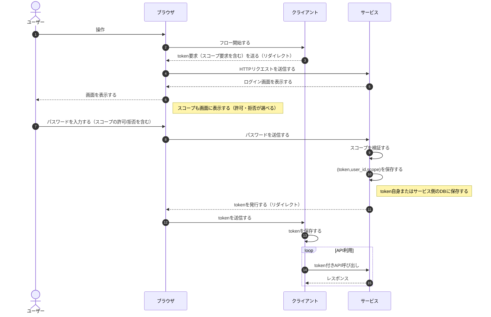
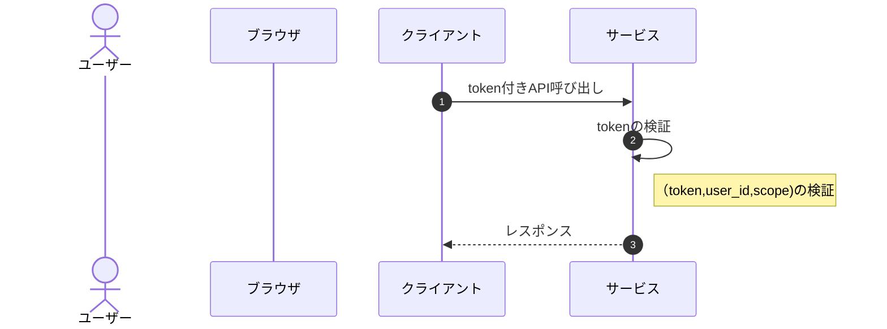
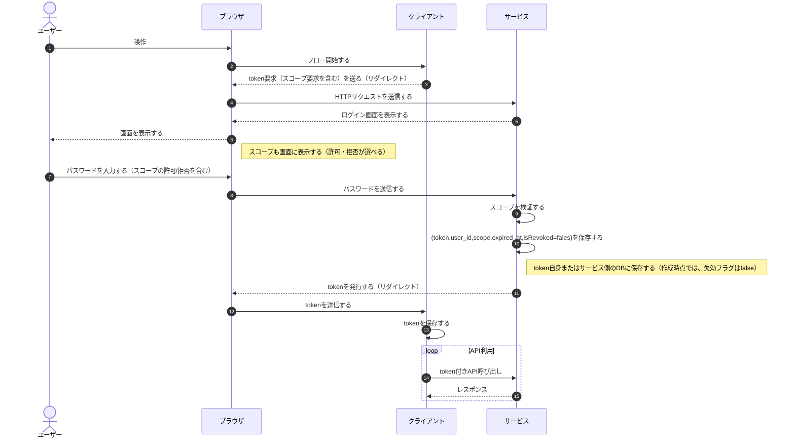
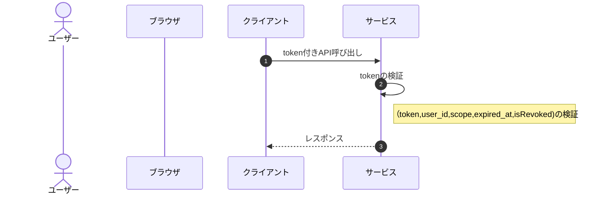

# Day4

今回はDay3に引き続き、セキュリティ改善を進めていきます。Day3で残っていたのは以下の3つです：

2. tokenの失効方法が規定されていない（無期限で使えてしまう）
3. tokenがずっと使い回されている（一度でも漏洩すると問題）
4. tokenはクライアント以外でも使える（漏洩すると簡単に悪用できる）

## Day3までの図（再掲）

### token発行時のシーケンス図

### token利用時のシーケンス図

## 2. token失効方法

まずは、2つ目の問題を対応していきます：

2. tokenの失効方法が規定されていない（無期限で使えてしまう）

### 失効のタイミングは？

まず前提として、失効するのは以下の2つのタイミングがあります：

- 有効期限を設けて自動で失効させる
- 任意のタイミングで手動で失効させる

なお、手動で失効させるのは、例えば、退会時や情報漏洩などで意図的に失効させる場合を想定しています。

この二つのタイミングを考慮すると、「有効期限」と「失効（フラグ）」の2つの情報を保持する必要がありそうです。これらは、素直にscope設定と同じタイミングで設定/検証するのがよさそうです。

### 設計への反映

前節の通り、「有効期限」と「失効（フラグ）」をZeroAuthのフローに反映させます。なお、scopeとの違いは、「有効期限」と「失効（フラグ）」はサービス側が設定するもの（「失効（フラグ）」については、任意のタイミングでサービス（ユーザーや管理者）が設定する）という点です。

考慮事項はこれ以上なさそうなので、シーケンス図に反映して、解決です。

> [!NOTE]
> 現在、サービスがtokenの検証をしていますが、実際のOAuthではサービスとは別にIdP（Identity Provider）が登場します。この場合でtokenをJWTにしている場合、失効フラグをリアルタイムで反映できない課題があります。ただし、day4時点ではこれ以上深掘りしないことにします（いずれ、IdPについても検討したいと思います）。

### token発行時のシーケンス図

#### token利用時のシーケンス図

## 3. tokenがずっと使い回されている

次に、3つ目の問題を考えていきます。前節で、有効期限

3. tokenがずっと使い回されている（一度でも漏洩すると問題）

こちらは、tokenをローテーションする方針で解決していきたいと思います。

### 設計案を比較する

ローテーションするにあたり、気になる点は以下の3つです：

- ①ローテーションのタイミングは？
  - 選択肢1：tokenは一度使ったらローテーションする
  - 選択肢2：有効期限の前に交換する
  - 選択肢3：有効期限が切れた後（もしくは失効した後）に交換する
- ②ローテーションするときの認証は？
  - 選択肢1：ユーザー認証を求める
  - 選択肢2：tokenを持っていることで認証とする
  - 選択肢3：ローテーション用のtokenを用意し、それで認証する
- ③古いtokenは即失効とする？
  - 選択肢1：即失効とする
  - 選択肢2：元々の有効期限に従う

